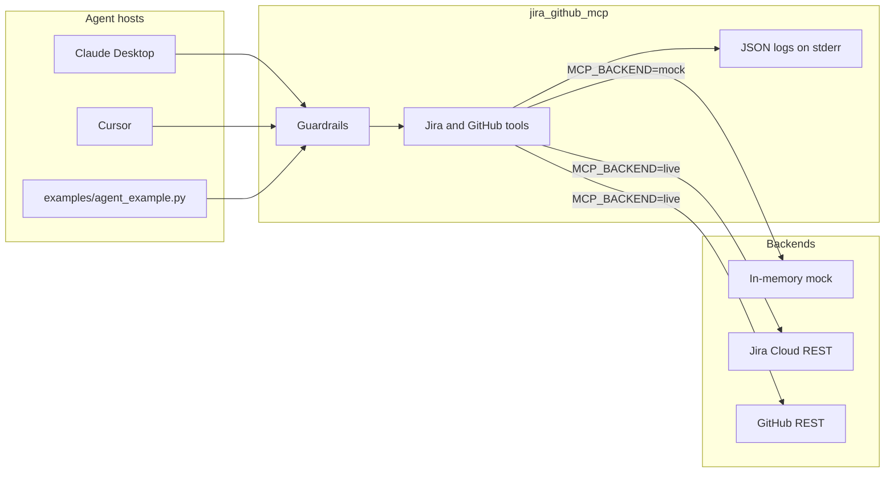

# Jira + GitHub MCP server

**This is a portfolio demo, not a production integration.** It shows how an AI agent can call Jira and GitHub through the [Model Context Protocol](https://modelcontextprotocol.io). The default backend is an in-memory fake. Nothing here is affiliated with Atlassian or GitHub, and the live clients are thin REST wrappers rather than a hardened gateway.

[](https://github.com/applycoding/mcp-jira-github-server/actions/workflows/ci.yml)

## What it demonstrates

- An MCP server built with the official Python SDK (`mcp` 2.x, `MCPServer`).
- Eight tools: search, create, comment, and transition on Jira; list pull requests, summarize a diff, create an issue, and comment on GitHub.
- Tokens come from the environment. The mock backend starts with no credentials.
- Input validation, a per-tool rate limit, read-only mode, and allowlists for tools, Jira projects, and GitHub repositories.
- JSON logs on stderr, so they do not collide with the MCP stdio stream. Argument values are not logged.

## Architecture



A client speaks MCP over stdin and stdout. Each tool call is checked against the allowlists and read-only flag, validated, then rate-limited. The service calls either the mock store or the live REST client. Logs go to stderr.

## Tools

| Tool | Mode | What it does |
| --- | --- | --- |
| `jira_search_issues` | read | Search issues. Mock filters: `project:PLAT`, `status:"In Progress"`, `type:Bug`, `key:PLAT-101`, plus free text. |
| `jira_create_issue` | write | Create a Bug, Task, or Story. Mock issues start as Open. |
| `jira_add_comment` | write | Comment on an issue key such as `PLAT-101`. |
| `jira_transition_issue` | write | Change status. Mock workflow: Open → In Progress → In Review → Done, plus Open → Done. Repeating the current status is a no-op. |
| `github_list_pull_requests` | read | List pull requests. `state` is `open`, `closed`, or `all`. |
| `github_get_pr_diff_summary` | read | File list with additions, deletions, and a short overview. This is a summary, not the raw patch. |
| `github_create_issue` | write | Open a GitHub issue. |
| `github_add_comment` | write | Comment on an issue or pull request number. |

In live mode, a query that contains `=`, `~`, `ORDER BY`, or `IN (` is sent to Jira as JQL. Anything else is translated from the mock filter syntax. Results are still dropped when they fall outside `JIRA_PROJECT_ALLOWLIST`.

## Mock workspace

The fake data is one small story so a demo agent has something to read:

- **PLAT-101** (Bug, Open) — SSO callback drops `state` and returns 500.
- **PLAT-102** (Story, In Progress) — audit every agent tool call.
- **MOB-14** (Task, Open) — cache pull request summaries for a mobile review bot.
- **acme/platform#41** — closed spike for an in-memory rate limiter.
- **acme/platform#42** — open PR, structured audit logging (160 additions).
- **acme/platform#43** — open PR, reject SSO callbacks that are missing state.
- **acme/platform#7** — open issue documenting the mock query syntax.

The mock GitHub client only knows `acme/platform`. Other repositories return not found.

## Setup

Requires Python 3.11+.

```bash
python -m venv .venv
source .venv/bin/activate
pip install -e ".[dev]"
```

Run the server on stdio (this is what Claude Desktop and Cursor launch; it waits for MCP messages):

```bash
python -m jira_github_mcp
```

Or the console script: `jira-github-mcp`.

Try the example client, which starts the server itself, lists the tools, searches Jira for the SSO bug, and summarizes pull request 43:

```bash
python examples/agent_example.py
```

That script forces `MCP_BACKEND=mock` and `MCP_READ_ONLY=true`.

### Claude Desktop

Merge `examples/claude_desktop_config.json` into the Claude Desktop config (`claude_desktop_config.json`). `jira-github-mcp` must be on the PATH of the app, or replace `command` with the full path to the executable inside your virtualenv.

### Cursor

Project config lives in `.cursor/mcp.json`. `examples/cursor_mcp.json` is a starting point: mock backend, read-only, limited to the `PLAT` project and `acme/platform`. Use the same Python environment that has this package installed.

## Configuration

See `.env.example`. All of these are optional in mock mode.

| Variable | Default | Purpose |
| --- | --- | --- |
| `MCP_BACKEND` | `mock` | `mock` or `live`. |
| `MCP_READ_ONLY` | `false` | When `true`, write tools return `read_only`. |
| `MCP_TOOL_ALLOWLIST` | empty (all tools) | Comma-separated tool names. Unknown names fail at startup. |
| `JIRA_PROJECT_ALLOWLIST` | empty (all projects) | Comma-separated project keys. |
| `GITHUB_REPO_ALLOWLIST` | empty (all repos) | Comma-separated `owner/repo` values. |
| `MCP_RATE_LIMIT_PER_MINUTE` | `60` | Per tool. `0` disables the limit. |
| `LOG_LEVEL` | `INFO` | `DEBUG`, `INFO`, `WARNING`, `ERROR`, or `CRITICAL`. |
| `JIRA_BASE_URL` | empty | Live only. Must be `https://`. |
| `JIRA_EMAIL` | empty | Jira Cloud account email. |
| `JIRA_API_TOKEN` | empty | Jira Cloud API token. Sent as Basic auth with the email. |
| `GITHUB_TOKEN` | empty | GitHub token sent as `Authorization: Bearer`. |

Live mode refuses to start until the four credential variables are set. A Jira base URL that is not HTTPS is rejected so the token is not sent in the clear.

## Security notes

- Tokens are read from the environment. They are not written to logs, and the repo has no sample secrets.
- Logs include the tool name, success flag, error code, and duration. They do not include argument values.
- Read-only mode and the allowlists are for safe demos. Turn read-only on before pointing a live token at an agent.
- The rate limit is in-memory and per process. Restarting the server clears it. It is not a quota system.
- Validation limits string length and checks the shape of issue keys, project keys, and repository names. It is not a JQL sandbox. In live mode, raw JQL is passed to Jira, and the token's own permissions are the real boundary. The project allowlist filters rows after the call.
- Live HTTP errors return a short status line to the agent. They do not include request headers.
- This demo does not do SSO, audit storage, secret scanning, or multi-tenant isolation.

## Tests and CI

Unit tests talk to the mock store and to live clients with a fake HTTP transport. They do not call Jira or GitHub.

GitHub Actions (`.github/workflows/ci.yml`) installs the package, runs Ruff, and runs pytest on Python 3.12. That workflow is the test run for this repo.

```bash
ruff check .
pytest -q
```

## Layout

```text
src/jira_github_mcp/    MCP server, guardrails, mock and live clients
examples/               Claude Desktop config, Cursor config, example client
tests/                  pytest against the mock backends and fake HTTP
.github/workflows/ci.yml
```

## Limitations

- Mock mode does not evaluate JQL. Use the `field:value` filters above.
- Live mode does not page past the first response, and a diff summary is aggregated from the pull request files API rather than a review of the patch.
- Jira auth is the Cloud email-plus-API-token pair, not a bearer personal access token.
- The mock workflow statuses are fixed. Live mode matches a transition by name or destination status, so the caller has to use a name that project actually has.
- There is no persistence. Mock writes disappear when the process exits.
